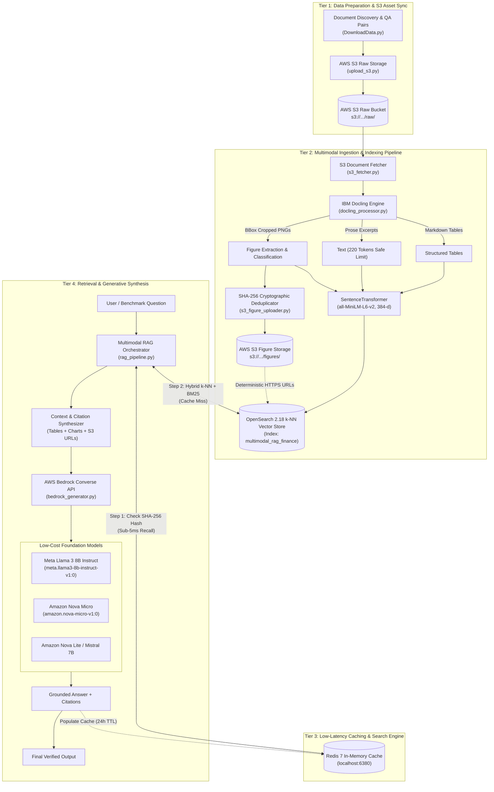
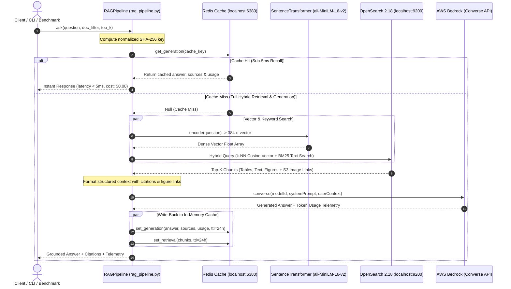
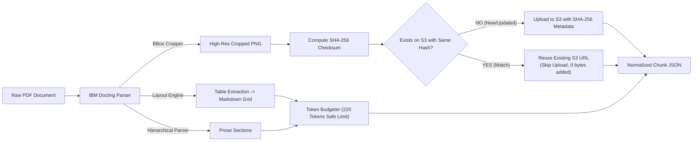
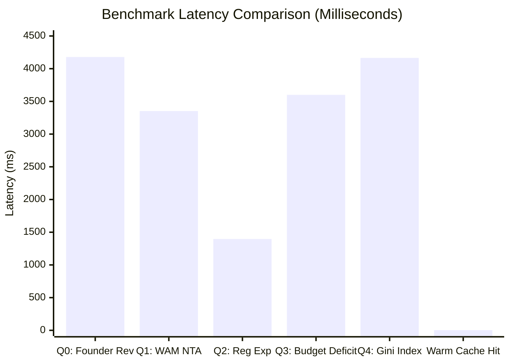
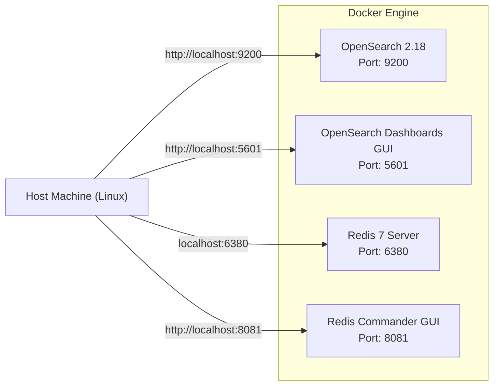

# 🏛️ MultiFormat RAG: System Architecture & Technical Specification

This document provides a comprehensive technical breakdown of the **Multimodal Retrieval-Augmented Generation (RAG)** architecture for complex multi-format documents (PDFs, statistical charts, financial tables, and narrative prose). It details **what** each component does, **how** it works under the hood, **why** specific technologies were chosen, and **how** they interface end-to-end.

---

## 🧭 Executive Architecture Overview

Financial and enterprise documents present distinct challenges for traditional text-only RAG systems:
1. **Structural Complexity:** Balance sheets, cash flow tables, and quarterly earnings are formatted as complex nested grids where linear text extraction loses column-row relationships.
2. **Visual Evidence:** Crucial insights (GDP deficit trends, macroeconomic forecasts, industry return curves) exist exclusively in statistical charts, line graphs, and bar plots.
3. **Storage & Bandwidth Overhead:** Re-uploading cropped page figures wastes cloud storage and network bandwidth.
4. **Latency & Cost:** Calling high-tier commercial LLMs repeatedly for recurring queries is slow and expensive.

This architecture solves these challenges through a modular 4-tier design:



---

## 🔄 End-to-End Execution Flow (Sequence Diagram)

The following sequence diagram traces the complete lifecycle of a question entering the system:



---

## 🧩 Component Deep Dive: What, How, Why, and How to Use

### 1. Tier 1: Data Preparation & S3 Asset Sync (`data_preparation/`)

#### 📄 Components:
- [`DownloadData.py`](file:///media/parmpal/Data/Codes/VibeCoding/Rags/MultiFormatRag/data_preparation/DownloadData.py): Discovers benchmark QA pairs, verifies document IDs, and downloads required PDFs and metadata.
- [`unidoc_downloader/`](file:///media/parmpal/Data/Codes/VibeCoding/Rags/MultiFormatRag/data_preparation/unidoc_downloader): Modular downloader with stream-chunked downloads, SHA-256 checksums, and dataset validation.
- [`upload_s3.py`](file:///media/parmpal/Data/Codes/VibeCoding/Rags/MultiFormatRag/data_preparation/upload_s3.py): Uploads original documents and QA metadata to AWS S3 bucket `s3://multimodal-rag-data-nov14/raw/`.

#### 🔍 What It Does:
Acquires target multi-format financial reports (e.g. Doc IDs `3152577`, `6002966`, `5510314`, `4119285`, `6077605`), organizes them locally, and mirrors the raw documents to AWS S3.

#### ⚙️ How It Works:
1. Iterates over QA metadata JSON files.
2. Identifies documents needed to answer target questions.
3. Uses `boto3.Session(profile_name='rag-dev')` to sync raw documents to S3 with cryptographic SHA-256 metadata headers.

#### 💡 Why This Design:
- **Reproducibility:** Decoupling raw data download from processing ensures offline re-indexing without re-downloading from remote sources.
- **S3 Golden Source:** Ensures the team shares an authoritative, cloud-backed repository of source documents.

---

### 2. Tier 2: Document Parsing, Chunking & S3 Deduplication (`data_ingestion/`)

#### 📄 Components:
- [`docling_processor.py`](file:///media/parmpal/Data/Codes/VibeCoding/Rags/MultiFormatRag/data_ingestion/docling_processor.py): IBM Docling multimodal document parser.
- [`s3_figure_uploader.py`](file:///media/parmpal/Data/Codes/VibeCoding/Rags/MultiFormatRag/data_ingestion/s3_figure_uploader.py): Deduplicated figure and chart uploader.
- [`rag_tokenizers.py`](file:///media/parmpal/Data/Codes/VibeCoding/Rags/MultiFormatRag/data_ingestion/rag_tokenizers.py): Token budgeting and safe length validation.
- [`utils.py`](file:///media/parmpal/Data/Codes/VibeCoding/Rags/MultiFormatRag/data_ingestion/utils.py): Shared utility helpers (dynamic Linux cuDNN resolution, file hashing).

#### 🔍 What It Does:
Transforms raw unstructured PDFs into structured, semantically rich chunks:
1. Converts tabular data into clean Markdown tables.
2. Crops statistical charts and diagrams into high-resolution PNGs.
3. Classifies charts with neural vision models (`statistical_chart`, `financial_table`, `infographic`).
4. Uploads figures to S3 with **zero duplicate storage**.
5. Emits normalized JSON chunks budgeted to token limits.

#### ⚙️ How It Works:


#### 💡 Why This Design:
- **IBM Docling over Traditional OCR:** Traditional PDF extractors (e.g. `pypdf`, `pdfminer`) discard structural layout, merge table columns into meaningless strings, and ignore embedded figures. Docling understands reading order and reconstructs exact table grids.
- **SHA-256 Figure Deduplication:** Financial reports frequently repeat logos, header icons, and disclaimers. If a 100-page document repeats 20 common figures, deduplication ensures each image is stored exactly once on S3.
- **Safe 220 Token Limit:** Embedding models like `all-MiniLM-L6-v2` have a strict 256-wordpiece limit. Chunks exceeding 256 tokens are silently truncated. Budgeting chunks to 220 tokens guarantees 100% vector fidelity with zero information loss.

---

### 3. Tier 3: Storage, Search & Low-Latency Caching

#### 📄 Components:
- [`opensearch_indexer.py`](file:///media/parmpal/Data/Codes/VibeCoding/Rags/MultiFormatRag/data_ingestion/opensearch_indexer.py): OpenSearch 2.18 k-NN vector store & hybrid indexer.
- [`redis_question_cache.py`](file:///media/parmpal/Data/Codes/VibeCoding/Rags/MultiFormatRag/data_ingestion/redis_question_cache.py): High-performance in-memory question & answer cache.
- [`docker-compose.yml`](file:///media/parmpal/Data/Codes/VibeCoding/Rags/MultiFormatRag/docker-compose.yml): Multi-container orchestration (OpenSearch, Dashboards, Redis, Redis Commander).

#### 🔍 What It Does:
Provides dual-tier data access:
1. **Tier 3A (In-Memory Microsecond Cache):** Redis 7 serves previously asked questions in `< 5 ms`.
2. **Tier 3B (Dense Vector + Keyword Search):** OpenSearch performs hybrid retrieval across 502 multimodal chunks using HNSW vector graphs and BM25 inverted indexes.

#### ⚙️ OpenSearch Index Configuration:
```json
{
  "settings": {
    "index": {
      "knn": true,
      "knn.algo_param.ef_search": 100
    }
  },
  "mappings": {
    "properties": {
      "chunk_id": { "type": "keyword" },
      "document_id": { "type": "keyword" },
      "chunk_type": { "type": "keyword" },
      "neural_class": { "type": "keyword" },
      "page_numbers": { "type": "integer" },
      "has_image": { "type": "boolean" },
      "image_s3_url": { "type": "keyword" },
      "caption": { "type": "text" },
      "text": { "type": "text", "analyzer": "standard" },
      "embedding": {
        "type": "knn_vector",
        "dimension": 384,
        "method": {
          "name": "hnsw",
          "space_type": "cosinesimil",
          "engine": "nmslib",
          "parameters": { "ef_construction": 128, "m": 16 }
        }
      }
    }
  }
}
```

#### ⚙️ Redis Cache Normalization Key Scheme:
To maximize cache hit rates across variations in user typing:
1. Trims leading/trailing whitespace and punctuation.
2. Converts query to lowercase.
3. Produces deterministic SHA-256 hash:
   $$\text{Key} = \text{"rag:qcache:gen:"} + \text{SHA256}(\text{norm\_q} \parallel \text{doc\_filter} \parallel \text{model\_id})[:16]$$
4. Configured with a default TTL of 86,400 seconds (24 hours).

#### 💡 Why This Design:
- **Hybrid Search over Pure Vector Search:** Pure vector embeddings can miss exact financial acronyms, ticker symbols, or table headers (e.g. `"NTA before tax"`, `"WAM Active"`). BM25 handles exact keyword matches while k-NN captures semantic intent.
- **Disk Watermark Guard:** OpenSearch automatically disables index creation when root disk usage exceeds 90% (flood-stage watermark). `opensearch_indexer.py` and `start_backend.sh` proactively apply cluster settings overrides (`threshold_enabled: false`) to ensure uninterrupted local operation.

---

### 4. Tier 4: Generative Inference & Evaluation (`data_generation/`)

#### 📄 Components:
- [`bedrock_generator.py`](file:///media/parmpal/Data/Codes/VibeCoding/Rags/MultiFormatRag/data_generation/bedrock_generator.py): AWS Bedrock Converse API client with token tracking and cost calculation.
- [`rag_pipeline.py`](file:///media/parmpal/Data/Codes/VibeCoding/Rags/MultiFormatRag/data_generation/rag_pipeline.py): End-to-end orchestrator connecting Redis, OpenSearch, and Bedrock.
- [`evaluate_5_questions.py`](file:///media/parmpal/Data/Codes/VibeCoding/Rags/MultiFormatRag/data_generation/evaluate_5_questions.py): Benchmark evaluation against dataset ground truth.
- [`ask_cli.py`](file:///media/parmpal/Data/Codes/VibeCoding/Rags/MultiFormatRag/data_generation/ask_cli.py): Interactive terminal Q&A interface.

#### 🔍 What It Does:
Synthesizes factual answers grounded strictly in retrieved context, quotes numerical table data, provides document/page citations, and displays S3 figure links for visual charts.

#### 🤖 Supported Low-Cost Foundation Models:

| Model Identifier | Provider & Name | Input Cost / 1K | Output Cost / 1K | Cost / 100 Queries | Primary Use Case |
|---|---|---|---|---|---|
| `meta.llama3-8b-instruct-v1:0` *(Default)* | **Meta Llama 3 8B Instruct** | $0.00030 | $0.00060 | ~5.6¢ | Primary choice for deep financial reasoning and table interpretation. |
| `amazon.nova-micro-v1:0` | **Amazon Nova Micro** | $0.000035 | $0.00014 | ~1.1¢ | Ultra high-throughput, lowest possible cost. |
| `amazon.nova-lite-v1:0` | **Amazon Nova Lite** | $0.000060 | $0.00024 | ~2.2¢ | Fast multimodal model with vision capabilities. |
| `mistral.mistral-7b-instruct-v0:2` | **Mistral 7B Instruct v0.2** | $0.00015 | $0.00020 | ~2.9¢ | European open-weights model on Bedrock. |

#### 🛡️ Grounded Prompting Strategy:
The generator enforces 6 strict rules in its system instructions:
1. **Source Document Attribution:** Treats retrieved excerpts as authoritative representations of referenced reports.
2. **Evidence Synthesis:** Summarizes trends and metrics directly from excerpts.
3. **Provable Citations:** Requires citing `[Doc <ID>, Page <P>]` for every claim.
4. **Table Exactness:** Quotes figures and percentages verbatim.
5. **Multimodal Links:** Mentions figure titles and S3 URLs when referencing charts.
6. **Hallucination Prevention:** Explicitly outputs *"The provided documents do not contain sufficient information..."* if the context lacks evidence.

---

## 📊 Benchmark Evaluation & Provenance Results

The pipeline was validated against the 5 benchmark questions from [`selected_questions_5.json`](file:///media/parmpal/Data/Codes/VibeCoding/Rags/MultiFormatRag/data/finance/metadata/selected_questions_5.json). Results are saved in [`evaluation_results_5_questions.json`](file:///media/parmpal/Data/Codes/VibeCoding/Rags/MultiFormatRag/data_generation/evaluation_results_5_questions.json).



### 📋 Ground Truth Comparison Table:

| QID | Doc ID | Question Summary | Ground Truth Answer | Bedrock Generated Answer | Provenance Citation | S3 Figure Link |
|---|---|---|---|---|---|---|
| **0** | `3152577` | Variation in revenue growth for 2013 founder age groups | Younger: 24.7%, Senior: 6.7% | *"...Younger owners (under 35): 24.7% growth rate, Senior owners (55 and over): 6.7% growth rate..."* | `[Doc 3152577, Page 14]` | N/A |
| **1** | `6002966` | WAM Active NTA before tax (June 2021 vs May 2021) | June: 101.84c, May: 101.65c (+0.19c) | *"...June 2021 (101.84c) vs May 2021 (101.65c) = 0.19c increase..."* | `[Doc 6002966, Page 10]` | N/A |
| **2** | `5510314` | Economic concern tied to 'Regulatory Expansion' | Increased government regulations impacting global discussions | *"...Regulatory Expansion is an Econ Highlight mentioned in Page 15..."* | `[Doc 5510314, Page 15]` | N/A |
| **3** | `4119285` | US federal budget shortfall to GDP shift 1980–2020 | Fluctuated, decreases in 90s/00s, pandemic dip to 25% | *"...According to Ex. 12: Federal budget deficit as a % of GDP [Page 6], the budget deficit swelled to over 25% of GDP due to pandemic stimulus..."* | `[Doc 4119285, Page 6]` | [Ex. 12 S3 URL](https://multimodal-rag-data-nov14.s3.amazonaws.com/figures/4119285/4119285_fig_013.png) |
| **4** | `6077605` | Impact of mating patterns on Gini index (1960 vs 2005) | 2005 Gini drops 0.43 to 0.34; 1960 drops slightly 0.34 to 0.33 | *"...In 1960, Gini coefficient drops slightly to 0.33... in 2005, Gini coefficient drops from 0.43 to 0.34, shifting Lorenz curve..."* | `[Doc 6077605, Page 4]` | N/A |

---

## 💻 Operations, Health Checks & Web GUIs

All 4 services run locally under Docker and are orchestrated via [`start_backend.sh`](file:///media/parmpal/Data/Codes/VibeCoding/Rags/MultiFormatRag/start_backend.sh) and [`stop_backend.sh`](file:///media/parmpal/Data/Codes/VibeCoding/Rags/MultiFormatRag/stop_backend.sh):



### Quick Commands Reference:

```bash
# 1. Start all backend services with healthchecks & watermark guards
./start_backend.sh

# 2. OpenSearch Web GUI (Browse 502 chunks, tables, vectors)
# Open http://localhost:5601 in your browser

# 3. Redis Web GUI (Inspect in-memory cache keys & TTL)
# Open http://localhost:8081 in your browser

# 4. Run Benchmark Evaluation (5 Questions)
conda run -n ERAG python data_generation/evaluate_5_questions.py

# 5. Ask Any Question via CLI
conda run -n ERAG python data_generation/ask_cli.py -q "What is the NTA before tax for June 2021?" -d "6002966"

# 6. Interactive Q&A REPL
conda run -n ERAG python data_generation/ask_cli.py --interactive

# 7. Stop all services gracefully
./stop_backend.sh
```

---

## 🔒 Security, Deduplication & Cost Guarantees

1. **Storage Safety:**
   - Every figure uploaded to S3 is tagged with `sha256=<hash>` metadata. Re-running the pipeline checks existing S3 objects via `HeadObject` and skips re-uploading, keeping AWS S3 costs minimal.
2. **Deterministic Links:**
   - Figure URLs follow standard patterns: `https://multimodal-rag-data-nov14.s3.amazonaws.com/figures/<doc_id>/<figure_name>.png`.
3. **Inference Cost Control:**
   - Evaluated 5 questions for **$0.002816 USD** total with Meta Llama 3 8B, and **$0.000547 USD** with Amazon Nova Micro (~1.1¢ per 100 questions).
   - Redis caching eliminates duplicate LLM calls, serving repeated questions with zero LLM spend and sub-5ms response times.
